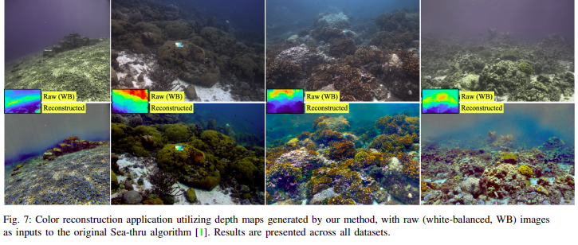

# Gaussian Splashing: Direct Volumetric Rendering Underwater
Nir Mualem, Roy Amoyal, Oren Freifeld,  Derya Akkaynak<br>
| [Webpage](https://repo-sam.inria.fr/fungraph/3d-gaussian-splatting/) | [Full Paper](https://repo-sam.inria.fr/fungraph/3d-gaussian-splatting/3d_gaussian_splatting_high.pdf) | [TableDB dataset](https://youtu.be/T_kXY43VZnk) | <br>


This repository contains the official authors implementation associated with the paper "Gaussian Splashing: Direct Volumetric Rendering Underwater", which can be found [here](https://repo-sam.inria.fr/fungraph/3d-gaussian-splatting/). The implementation is based on the awsom repositoty and work of [3D Gaussian Splatting
for Real-Time Radiance Field Rendering](https://repo-sam.inria.fr/fungraph/3d-gaussian-splatting/) 


Abstract: *In underwater images, most useful features are occluded by water. The extent of the occlusion depends on imaging geometry and can vary even across a sequence of burst images. As a result, 3D reconstruction methods robust on in-air scenes, like Neural Radiance Field methods (NeRFs) or 3D Gaussian Splatting (3DGS), fail on underwater scenes. While a recent underwater adaptation of NeRFs achieved state-of-the-art results, it is impractically slow: reconstruction takes hours and its rendering rate, in frames per second (FPS), is less than 1. Here, we present a new method that takes only a few minutes for reconstruction and renders novel underwater scenes at 140 FPS. Named Gaussian Splashing, our method unifies the strengths and speed of 3DGS with an image formation model for capturing scattering, introducing innovations in the rendering and depth estimation procedures and in the 3DGS loss function. Despite the complexities of underwater adaptation, our method produces images at unparalleled speeds with superior details. Moreover, it reveals distant scene details with far greater clarity than other methods, dramatically improving reconstructed and rendered images. We demonstrate results on existing datasets and a new dataset we have collected.*

<section class="section" id="BibTeX">
  <div class="container is-max-desktop content">
    <h2 class="title">BibTeX</h2>
    <pre><code>@Article{kerbl3Dgaussians,
      author       = {Kerbl, Bernhard and Kopanas, Georgios and Leimk{\"u}hler, Thomas and Drettakis, George},
      title        = {3D Gaussian Splatting for Real-Time Radiance Field Rendering},
      journal      = {ACM Transactions on Graphics},
      number       = {4},
      volume       = {42},
      month        = {July},
      year         = {2023},
      url          = {https://repo-sam.inria.fr/fungraph/3d-gaussian-splatting/}
}</code></pre>
  </div>
</section>


## Funding and Acknowledgments


## Cloning the Repository

The repository contains submodules, thus please check it out with 
```shell
# SSH
git clone git@github.com:graphdeco-inria/gaussian-splatting.git --recursive
```
or
```shell
# HTTPS
git clone https://github.com/graphdeco-inria/gaussian-splatting --recursive
```

## Overview

The codebase is based on [3DGS implementation](https://github.com/graphdeco-inria/gaussian-splatting/) which has excellent overview for most of the params and datset use, please read it in advance.


### Software Requirements
- Conda (recommended for easy setup)
- C++ Compiler for PyTorch extensions (we used Visual Studio 2019 for Windows)
- CUDA SDK 12 for PyTorch extensions, install *after* Visual Studio.
- C++ Compiler and CUDA SDK must be compatible

### Setup

#### Local Setup

Our default, provided install method is based on Conda package and environment management:
```shell
SET DISTUTILS_USE_SDK=1 # Windows only
conda env create --file environment.yml
conda activate gaussian_splattingUW
```
### Running

To run the optimizer, simply use

```shell
python train.py -s <path to COLMAP dataset>
```

<details>
<summary><span style="font-weight: bold;">Command Line Arguments for train.py</span></summary>

  #### --source_path / -s
  Path to the source directory containing a COLMAP or Synthetic NeRF data set.
  #### --model_path / -m 
  Path where the trained model should be stored (```output/<random>``` by default).
  #### --images / -i
  Alternative subdirectory for COLMAP images (```images``` by default).


</details>
<br>


We further provide the ```full_eval.py``` script. This script specifies the routine used in our evaluation and demonstrates the use of some additional parameters, e.g., ```--images (-i)``` to define alternative image directories within COLMAP data sets. If you have downloaded and extracted all the training data, you can run it like this:
```shell
python full_eval.py -m360 <mipnerf360 folder> -tat <tanks and temples folder> -db <deep blending folder>
```
In the current version, this process takes about 7h on our reference machine containing an A6000. If you want to do the full evaluation on our pre-trained models, you can specify their download location and skip training. 
```shell
python full_eval.py -o <directory with pretrained models> --skip_training -m360 <mipnerf360 folder> -tat <tanks and temples folder> -db <deep blending folder>
```

If you want to compute the metrics on our paper's [evaluation images](https://repo-sam.inria.fr/fungraph/3d-gaussian-splatting/evaluation/images.zip), you can also skip rendering. In this case it is not necessary to provide the source datasets. You can compute metrics for multiple image sets at a time. 
```shell
python full_eval.py -m <directory with evaluation images>/garden ... --skip_training --skip_rendering
```

<details>
<summary><span style="font-weight: bold;">Command Line Arguments for full_eval.py</span></summary>
  
  #### --skip_training
  Flag to skip training stage.
  #### --skip_rendering
  Flag to skip rendering stage.
  #### --skip_metrics
  Flag to skip metrics calculation stage.
  #### --output_path
  Directory to put renderings and results in, ```./eval``` by default, set to pre-trained model location if evaluating them.
  #### --mipnerf360 / -m360
  Path to MipNeRF360 source datasets, required if training or rendering.
  #### --tanksandtemples / -tat
  Path to Tanks&Temples source datasets, required if training or rendering.
  #### --deepblending / -db
  Path to Deep Blending source datasets, required if training or rendering.
</details>
<br>
